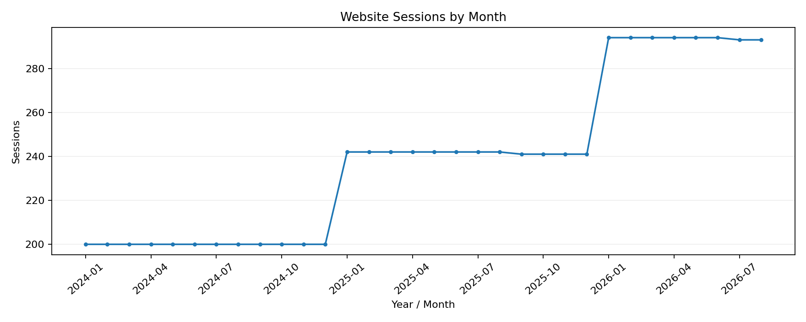
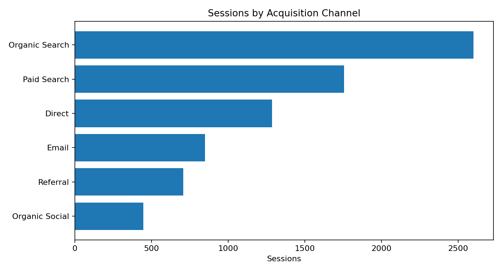
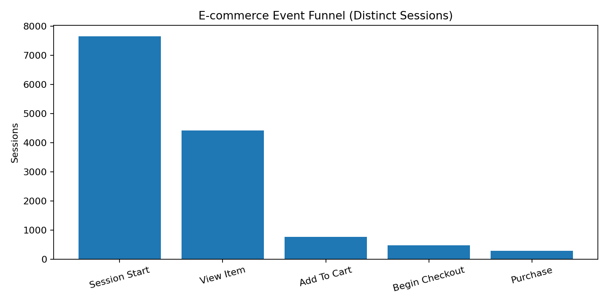

# Website Acquisition, Engagement & Conversion | GA4-Style Analytics Portfolio

**Google Analytics 4 concepts · Event analysis · Traffic acquisition · Engagement · E-commerce funnel**

## Project overview

A digital analytics case study examining UK e-commerce website sessions and GA4-style events across **2024, 2025 and January–August 2026**. The analysis connects traffic acquisition, engagement, landing-page behaviour, purchase journeys and revenue to business questions.

**Data:** A simulated GA4-style session and event dataset, not an export from a live Google Analytics property.

## Business questions

- Which acquisition channels drive traffic and sessions with key events?
- How does engagement differ by device and landing page?
- Where do website visitors exit the product-to-purchase journey?
- How did January–August traffic and revenue change on a like-for-like basis?
- Do purchase events reconcile with reported session revenue?

## Key performance indicators

| Reporting period | Sessions | Users | Engagement rate | Sessions with key event | Key-event session rate | Purchase revenue |
|---|---:|---:|---:|---:|---:|---:|
| 2024 | 2,400 | 1,551 | 91.62% | 141 | 5.88% | £15,870 |
| 2025 | 2,900 | 1,732 | 92.41% | 150 | 5.17% | £16,594 |
| 2026 Jan-Aug | 2,350 | 1,514 | 92.81% | 121 | 5.15% | £13,286 |

**Like-for-like January–August comparison**

| Period | Sessions | Engagement rate | Purchase session rate | Purchase revenue |
|---|---:|---:|---:|---:|
| 2024 Jan-Aug | 1,600 | 91.94% | 4.25% | £11,107 |
| 2025 Jan-Aug | 1,936 | 92.41% | 3.62% | £11,691 |
| 2026 Jan-Aug | 2,350 | 92.81% | 3.57% | £13,286 |

## Acquisition and funnel insights

- **Organic Search** accounts for the most sessions (2,601), with a 5.15% session key-event rate.
- **mobile** represents the largest device group (4,502 sessions).
- The **/** landing page receives the most sessions (2,488).
- The funnel records **4,411 product-view sessions**, **771 add-to-cart sessions**, **468 checkout sessions**, and **284 purchase sessions**.
- Revenue is attributed to purchase events in this simulated session-level dataset; this is a descriptive case study, not evidence of campaign causality.

## Visual analysis

### Monthly traffic

### Acquisition channel mix

### E-commerce event funnel

## KPI definitions

- **Sessions:** Unique `session_id` values.
- **Engaged sessions:** Sessions lasting longer than 10 seconds, containing a key event, or recording at least two pageviews.
- **Engagement rate:** Engaged sessions / sessions.
- **Session key-event rate:** Sessions with at least one `purchase` or `generate_lead` event / sessions.
- **Purchase session rate:** Sessions with a `purchase` event / sessions.
- **Purchase revenue:** Sum of purchase-event values in GBP (no refunds or taxes modelled).
- **Funnel:** Unique sessions containing each event type. Stage totals describe observed events, not a path-ordered GA4 funnel exploration.

## Repository files

| File | Description |
|---|---|
| [ga4_sessions.csv](ga4_sessions.csv) | Session-level traffic, engagement and revenue |
| [ga4_events.csv](ga4_events.csv) | GA4-style event-level data |
| [analysis.py](analysis.py) | Reproducible analysis and chart generation |
| [result_annual_kpis.csv](result_annual_kpis.csv) | Annual KPI summary |
| [result_jan_aug_comparison.csv](result_jan_aug_comparison.csv) | Equivalent-period comparison |
| [result_channel_performance.csv](result_channel_performance.csv) | Acquisition performance |
| [result_device_performance.csv](result_device_performance.csv) | Device engagement and conversions |
| [result_landing_pages.csv](result_landing_pages.csv) | Landing-page metrics |
| [result_ecommerce_funnel.csv](result_ecommerce_funnel.csv) | Purchase journey stages |
| [result_monthly_performance.csv](result_monthly_performance.csv) | Monthly KPIs |
| [result_data_quality.csv](result_data_quality.csv) | Seven reconciliation/quality checks |
| [DATA_DICTIONARY.md](DATA_DICTIONARY.md) | Data fields, KPI logic and assumptions |
| [GA4_EXPLORATIONS.md](GA4_EXPLORATIONS.md) | GA4 reporting design and exploration specification |

## Tools and methods

**GA4 event and acquisition concepts · Python · CSV reporting · Matplotlib · Data reconciliation**

## Method and references

This portfolio project uses generated data aligned with selected GA4 measurement concepts. It does not imply deployment of the Google tag or access to a production GA4 property. GA4 naming and metric references: [Google Analytics engagement rate](https://support.google.com/analytics/answer/12195621) and [Google Analytics recommended events](https://developers.google.com/analytics/devguides/collection/ga4/reference/events).
